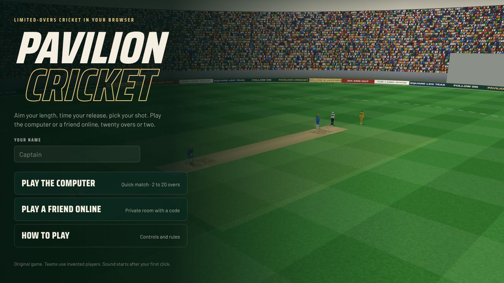
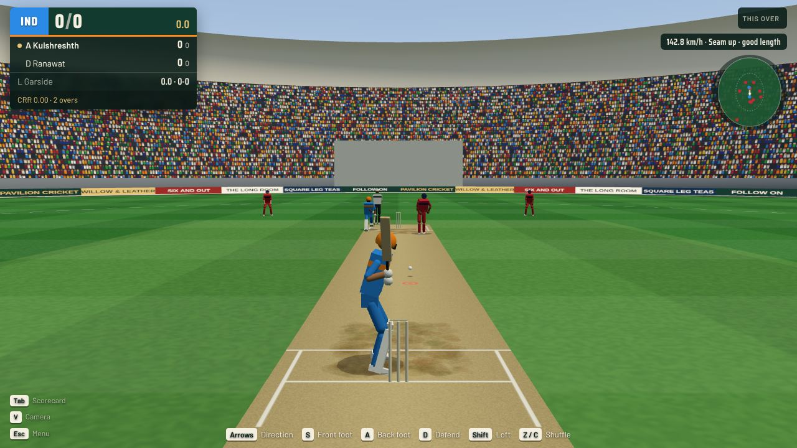
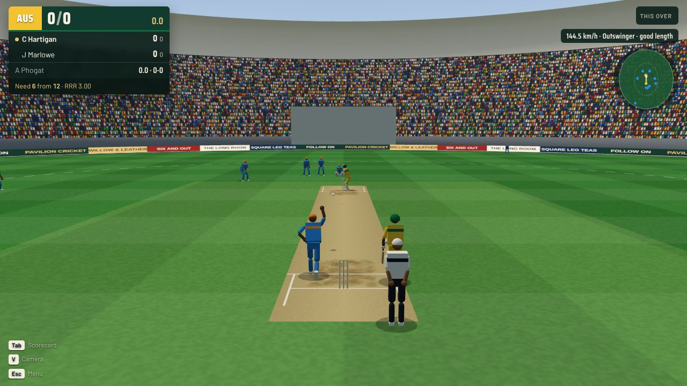
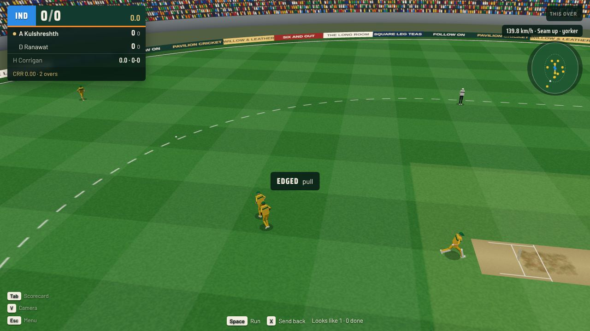
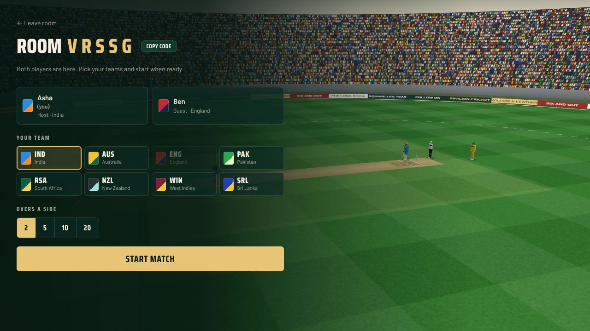
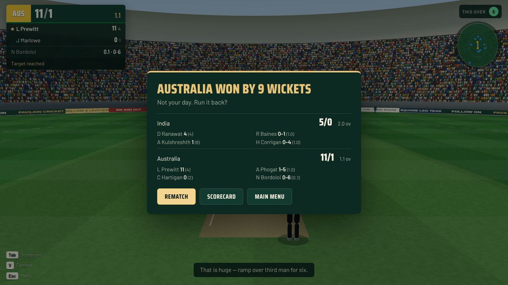

# Pavilion Cricket

An original 3D cricket game that runs in the browser. Aim a pitch marker and time a release
meter to bowl; pick footwork, direction and the moment to swing when you bat. Play a
limited-overs match against the computer, or a friend online with a five-letter room code.

Everything is generated in code: the stadium, players, animation and sound. There are no
image or audio files, and the whole game builds to a single 632 KB HTML file.

- [Product requirements](docs/PRD.md)
- [Architecture](docs/ARCHITECTURE.md)

| | |
|---|---|
|  |  |
|  |  |
|  |  |

## Run it

Needs Node 18 or newer.

```bash
cd pavilion-cricket
npm install
npm start
```

Open http://localhost:3000. The same server hosts online rooms, so a friend on your network
can open `http://<your-ip>:3000` and join with your code.

## Controls

| When | Keys |
|------|------|
| Bowling | Arrows move the pitch marker · `Q` `E` change delivery · `F` change field · `Space` to run in, `Space` again in the gold band to release (over the top is a no-ball) |
| Batting | Hold arrows for direction (up is straight back past the bowler) · `S` front-foot shot · `A` back-foot shot · `D` defend · hold `Shift` to loft · `Z` `C` shuffle across before the ball |
| Running | `Space` run · `X` send your partner back (the hint shows how many look safe) |
| Anywhere | `Tab` scorecard · `V` camera · `M` sound · `Esc` menu |

On a phone or tablet, an on-screen stick and buttons appear after the first touch.

**Batting tips.** Press as the ball arrives. Full balls suit the front foot, short balls the
back foot. Hitting with the line (cover for a ball outside off, leg side for one on the pads)
is safer than hitting across it. Only well-timed lofted shots clear the rope.

## Modes

- **Play the computer** — 2, 5, 10 or 20 overs a side, Easy, Medium or Hard.
- **Play a friend online** — one player creates a room and shares the code; the other joins.
  Each picks a team, the host picks the overs. Rematch from the result screen.

## Online play

Every match has one authority (the "host") that applies the rules and all randomness. Only
small per-ball messages cross the network — the delivery, the shot, run calls and the result
— so the game plays well over ordinary home connections. Your shot timing is measured on
your own screen, so lag never changes how well you timed it. If a connection drops, the seat
is held for 60 seconds and the player rejoins automatically.

There are two ways to host:

1. **The game server** (`npm start`). Static files and WebSocket rooms on one port.
2. **As a Claude artifact.** `npm run build` writes `dist/artifact.html`. In an artifact the
   room creator's browser is the host, and messages travel through the artifact's live room.
   Your friend must be signed in and able to open the artifact.

### Deploying the server

Any host that runs Node and supports WebSockets works.

- **Docker:** `docker build -t pavilion-cricket . && docker run -p 3000:3000 pavilion-cricket`
- **Render / Railway / Fly.io:** create a web service with root directory `pavilion-cricket`,
  build command `npm ci --omit=dev`, start command `node server/index.js`, health check `/health`.

Settings: `PORT` (default 3000), `MAX_ROOMS` (default 500). Rooms live in memory; idle rooms
are cleared after an hour, empty ones after two minutes.

## Build

```bash
npm run build
```

- `dist/pavilion-cricket.html` — opens straight from disk. Play the computer offline; for
  online play enter the address of a running server.
- `dist/artifact.html` — the same game packaged for a Claude artifact.

## Tests

```bash
npm test       # 100 computer-v-computer matches through the real host, checking every scoring rule,
               # then full two-player matches over the in-page link, the WebSocket server
               # (with a dropped and rejoined socket) and a simulated artifact room
npm run e2e    # headless Chromium: a match against the computer, then an online match
```

`node test/sim.mjs 300 20 medium` prints score distributions. Current balance for 20-over
computer matches: about 140 for 6 on Medium, 100 for 7 on Easy, 180 for 6 on Hard.

## Layout

```
shared/     match engine: rules, delivery physics, shot model, fielding, running, AI, host, rooms
server/     Node static + WebSocket server
client/     browser game: 3D scene, player rigs, game loop, HUD, input, audio, menus
scripts/    single-file builds
test/       simulation, transport and browser tests
docs/       PRD and architecture
```

## Credits

Built with [three.js](https://threejs.org) and [ws](https://github.com/websockets/ws).
Team names are countries; all player names are invented.
