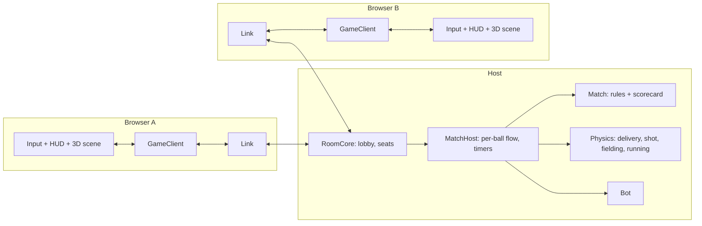
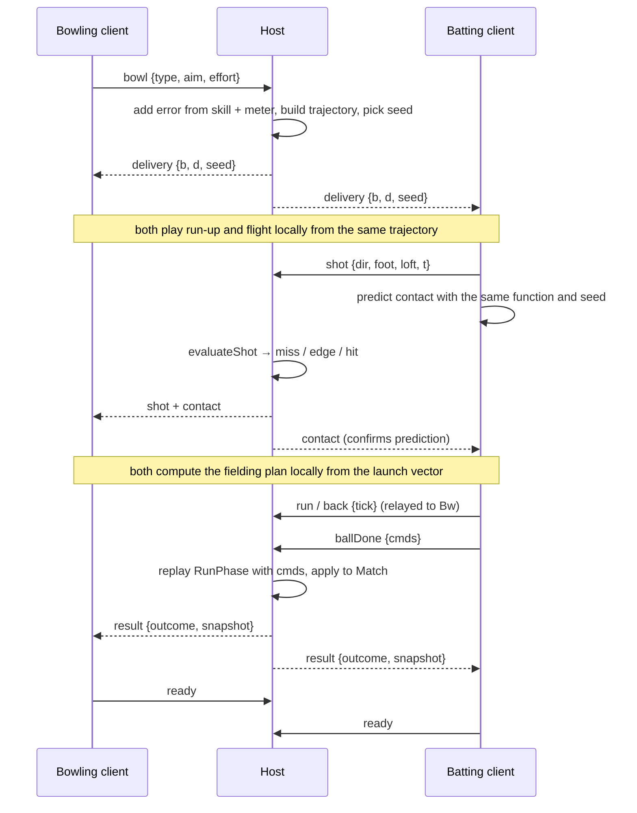

# Pavilion Cricket — Architecture

## 1. Shape of the system

One rule: **the match engine is plain JavaScript with no DOM and no network, and it runs
wherever the host is.** The client is a renderer and an input device in every mode.



Where the host lives depends on the mode:

| Mode | Host location | Link for player A | Link for player B |
|------|---------------|-------------------|-------------------|
| vs AI | In the page | `LocalLink` | Bot seat (no link) |
| Online, game server | Node process | `WsLink` | `WsLink` |
| Online, Claude artifact | Creator's page | `LocalLink` | `PresenceLink` over the artifact room |

All three use the same `RoomCore`, `MatchHost` and message protocol.

## 2. Repository layout

```
pavilion-cricket/
  shared/            engine — runs in Node and in the browser
    constants.js     ground and pitch dimensions, physics constants
    rng.js           seeded PRNG (integer arithmetic only)
    teams.js         squads and ratings
    delivery.js      bowling model → piecewise ball trajectory
    batting.js       shot evaluation → miss / edge / hit + launch vector
    fielding.js      field presets, ball flight, intercepts, RunPhase
    match.js         rules, scoring, scorecard, snapshot
    ai.js            bot: toss, bowler, field, delivery, shot, running
    host.js          MatchHost — authoritative per-ball state machine
    room.js          RoomCore — seats, lobby, start, rematch, disconnects
  server/index.js    static files + WebSocket rooms (one RoomCore per code)
  client/
    index.html       dev shell (ES modules, import map)
    styles.css
    src/main.js      screens and menus
    src/links.js     LocalLink, WsLink, PresenceLink
    src/game.js      GameClient — per-ball playback and control
    src/scene.js     stadium, pitch, stumps, ball, cameras
    src/players.js   humanoid rig and procedural animation
    src/hud.js       scoreboard, meter, radar, scorecard
    src/input.js     keyboard and touch
    src/audio.js     WebAudio synthesis
    src/commentary.js
    src/markup.js    DOM template
  scripts/build.mjs  single-file builds (offline HTML and artifact HTML)
  test/              engine simulation tests and browser end-to-end tests
```

## 3. World model

- Units are metres and seconds. Y is up. The pitch runs along Z, centred on the origin.
- Striker's stumps at `z = +10.06`, bowler's stumps at `z = −10.06`. The ball is bowled toward `+z`.
- For a right-hander the off side is `+x`; everything that depends on handedness uses `offSign`.
- The boundary is an ellipse of 62 m × 68 m semi-axes.

## 4. One ball, end to end



### Why this works over a slow connection

- **Nothing is streamed.** A ball is at most a dozen small messages. Each client animates
  from closed-form trajectories and a fixed-tick running simulation.
- **The batter's timing is measured on the batter's own clock.** The shot message carries the
  press time relative to release, so latency never changes what timing you get.
- **The batting client predicts.** `evaluateShot` is a pure function of the delivery, the shot
  and the seed, so the bat meets the ball with no round trip. The host's `contact` is the
  authority and normally matches exactly.
- **The non-acting client plays slightly late.** The bowling client stretches its run-up by a
  fraction of a second, so the opponent's swing and run calls arrive before they are due.
  A late run call is handled by replaying the running simulation from tick zero, which is cheap.
- **Results wait for the animation.** Clients file messages by ball number and apply the
  result only when their own playback of that ball has finished.

### Determinism

The fielding plan and `RunPhase` use only `+ − × ÷` and `sqrt` on values taken from the
messages, and a fixed 60 Hz tick, so two browsers get the same plan from the same launch
vector. Trigonometry and random numbers are used only on the host. If a client ever disagrees
with the host, the host's result and snapshot replace the client's view.

## 5. Physics models

**Delivery** (`delivery.js`). Release point, pace and landing spot define a projectile; the
vertical launch speed is solved so the ball lands on the (error-adjusted) marker. Swing is a
lateral acceleration with the initial sideways speed solved so the ball still lands on the
marker. At the bounce the ball loses pace, rebounds with a restitution that depends on pace,
and takes a sideways kick from cut or spin. The result is two or three parabolic segments;
`ballAt(d, t)` and `timeAtZ(d, z)` are closed-form.

**Shot** (`batting.js`). Contact plane depends on footwork. Timing error is press time minus
the ideal press time. Fit is the product of a line fit (ball position relative to the body
versus the side being hit to) and a length fit (ball height at the contact plane versus
footwork). Contact quality = timing quality × fit. Quality drives miss and edge
probabilities, exit speed, elevation and directional scatter. A miss is then checked against
the stumps (bowled or LBW), the wide lines, or goes through to the keeper.

**Fielding** (`fielding.js`). The hit is integrated with gravity, bounce and rolling friction
into a sampled path, with the rope crossing noted. Each fielder's earliest reachable sample
is found from reaction time, speed and reach; the earliest fielder is the chaser. If the ball
has not bounced it is a catch chance with a probability that falls as the chance gets tighter.

**Running** (`RunPhase`). A 60 Hz state machine: batters' progress and direction, queued run,
ball held / thrown / dead, throw target chosen by which end is most at risk, relay throws,
run-out test on arrival, dead ball when the ball is at the stumps and the batters are home.
It takes `(plan, commands[])` and is replayable.

## 6. Protocol

JSON objects with a `t` field. Ball-scoped messages carry the ball number `b`.

| Direction | Messages |
|-----------|----------|
| Client → room | `hello`, `cfg`, `start`, `rematch`, `leave` |
| Client → match | `tossChoice`, `pickBowler`, `field`, `bowl`, `shot`, `run`, `ballDone`, `ready`, `emote` |
| Host → client | `lobby`, `begin`, `toss`, `snap`, `turn`, `field`, `delivery`, `shot`, `contact`, `run`, `runs`, `result`, `void`, `peer`, `emote`, `error` |

`turn` invites the bowling side to pick a bowler or bowl. The host sends it only after every human has sent `ready` for the previous ball, which keeps the two screens within one ball of each other. `bowl` carries `rem`, the time left before release on the bowler's screen, so the batter's screen can show the same run-up length. `runs` carries a computer batter's run calls for the whole ball at once, and `result` repeats the final run calls so the other screen can replay the running exactly.

`snap` is the whole match in under 2 kB (scorecards as arrays), sent after every ball, so a
client never has to reconstruct state and a reconnecting client needs only one message.

## 7. Transports

- **LocalLink** — function calls deferred by a microtask.
- **WsLink** — JSON over WebSocket to `server/index.js`, with a seat token for reconnection.
- **PresenceLink** — for the Claude artifact, where WebSockets to other hosts are blocked.
  The artifact `room` capability gives each viewer a small presence object that the platform
  keeps in sync and re-asserts after reconnects. Each side publishes an outbox of unacknowledged
  message chunks plus an acknowledgement counter; the other side delivers new chunks in order
  and acknowledges. That gives ordered, reliable delivery on top of state sync, and it works
  for every viewer the room admits regardless of share role.

## 8. Server

`server/index.js` is a single Node process: an HTTP static server for `client/`, `shared/` and
the 3D library, and a WebSocket endpoint. It keeps a `Map` of rooms by code, each owning a
`RoomCore`. It enforces a message size limit and a per-socket rate limit, expires idle rooms,
and exposes `/health`. State is in memory; a restart ends matches in progress. One process
handles thousands of rooms because a ball costs a few messages and a few hundred microseconds.

## 9. Client

`GameClient` owns a small state machine per ball: `idle → aim → runup → flight → field →
aftermath → idle`. It reads input, drives the scene and HUD each frame, sends the player's
messages and plays back the opponent's. The scene is built from primitives and canvas
textures; players are jointed rigs posed by interpolating keyframes. The HUD is DOM over the
canvas.

## 10. Testing

- `test/sim.mjs` — plays AI v AI matches through the real host and checks rule invariants
  (balls per over, extras, strike, totals add up) and score distributions.
- `test/net.mjs` — full two-human matches with scripted clients over the in-page link, the
  WebSocket server (including a dropped and rejoined socket), and a simulated artifact room.
- `test/e2e.mjs` — headless Chromium: a full match against the computer with an in-page
  autoplayer, then an online match between two pages through the WebSocket server.

## 11. Deployment

- `npm start` serves the game and the WebSocket endpoint on one port (`PORT`, default 3000).
- A `Dockerfile` is included; the README lists settings for common Node hosts.
- `npm run build` writes `dist/pavilion-cricket.html` (self-contained, opens from disk,
  vs AI) and `dist/artifact.html` (the same game packaged for a Claude artifact).
